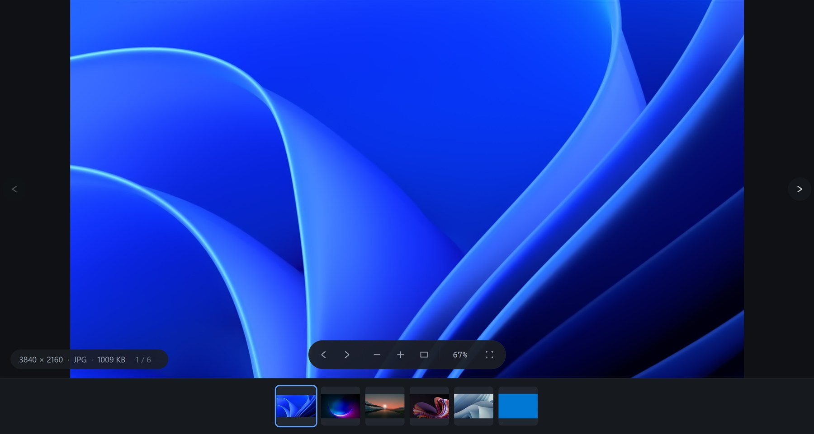

# 看看 / SeeSee

极速 Windows 看图工具。原生 C++20 + Win32 + Direct2D，**单文件 716 KB，无运行时依赖，冷启动 ~80 ms**，双击即看，键盘一路翻页。

> 解决系统看图工具的三件事：慢、功能不对味、广告多。v1 只做"快速看图"，照片管理留给 v2。



## 现在能做什么

- **极速开图**：从双击到图片上屏 80 ms 级（1920×1200），25.6 MP 的 6400×4000 JPEG 约 106 ms
- **同目录自动加载**：按自然序排好整目录，`←` `→` 一路翻；底部胶片条显示全部缩略图，点一下直达
- **解码级缩放**：JPEG 走 `IWICBitmapSourceTransform` 的 DCT 缩放（只解屏幕需要的像素），不是先解全图再缩
- **格式覆盖**：JPEG / PNG / BMP / GIF / TIFF / ICO / WebP；装过系统解码器则 AVIF / HEIC / JXL 也可
- **EXIF 方向**自动摆正；缩放以光标为锚，放大后可拖动，双击在「适应窗口 / 100%」间切换
- **底部胶片条**：`T` 开关，当前项描边高亮，±40 张范围后台低优先级预取缩略图
- **控件自动淡出**：看图时指针静止 2.6 s，底部控制条 / 信息胶囊 / 翻页箭头淡出，胶片条常驻
- **高 DPI**：按显示器真实 DPI 缩放，250% 4K 屏上字不糊也不小；`Ctrl+Shift+=/−` 可再整体放大
- `Ctrl+D` 一键设为默认看图工具（写 HKCU，不需要管理员权限）

## 下载 / 安装

从 [Releases](https://github.com/reloadbug/seesee/releases) 下载 `seesee.exe`，放到任意目录双击即用：

- 单文件、静态链接 CRT，不需要 .NET / VC++ 运行库
- 首次设置默认看图工具：程序内 `Ctrl+D`，或命令行 `seesee.exe --register`
- 卸载：删掉 exe；注册表用 `seesee.exe --unregister` 清理

## 快捷键

| 键 | 行为 |
| --- | --- |
| `←` `→` `↑` `↓` `PgUp` `PgDn` | 翻页 |
| `Home` / `End` | 第一张 / 最后一张 |
| `0` / `1` | 适应窗口 / 原始大小 |
| `+` / `-` | 放大 / 缩小 |
| 双击 | 适应窗口 ↔ 100% |
| 滚轮 / `Ctrl+滚轮` | 翻页 / 缩放 |
| `F11`、`Esc` | 全屏、退出全屏（再按关窗） |
| `Ctrl+O` / 拖放 | 打开文件 |
| `Ctrl+D` | 设为默认看图工具 |
| `T` | 显示 / 隐藏底部胶片条 |
| `Ctrl+Shift+=` / `Ctrl+Shift+-` | 界面整体放大 / 缩小 |

## 构建

需要 Visual Studio 2022 Build Tools（含 CMake、Ninja、Windows SDK）与 PowerShell：

```powershell
powershell -NoProfile -ExecutionPolicy Bypass -File .\build.ps1        # 只构建
powershell -NoProfile -ExecutionPolicy Bypass -File .\build.ps1 -Run   # 构建并运行
```

产物：`bin/seesee.exe`（静态链接，无运行时依赖）。

## 命令行

```
seesee.exe [图片路径]          打开图片
seesee.exe --register         设为默认看图工具并打开系统「默认应用」页
seesee.exe --unregister       取消关联
seesee.exe --bench <图片>      性能基准，分帧结果写入 seesee-bench.txt
seesee.exe --shot <png> <图片> 把首帧存成 PNG（UI 回归用，所见即所得）
seesee.exe --help             帮助
```

## 为什么是原生 + 软件渲染

- **不要 GPU**：实测 `D3D11CreateDevice` 冷启动要 **156 ms**（驱动初始化税），而 D2D 软件 DC 渲染目标只要 **9 ms**。看图工具的启动预算只有 150 ms，这块税付不起，所以用 `ID2D1DCRenderTarget` + 32bpp DIB + BitBlt，画面质量由 D2D 的抗锯齿保证，帧率仍有 60 fps 以上（4K 60 fps ≈ 16 ms/帧）。
- **不要 Electron**：运行时 + JS 引擎的启动开销就是两个数量级。
- **解码在前、建设备在后**：建窗 → 立刻发解码请求（worker 线程）→ 再显示窗口建 D2D 设备，两段并行，省掉一整个解码时间。

## 性能（本机 i5-12400F，空闲时实测）

| 场景 | 冷启动到首帧 | 稳态每帧 |
| --- | --- | --- |
| 1920×1200 JPEG | **80.6 / 81.7 / 84.2 ms** | 14.7–15.0 ms（~67 fps） |
| 6400×4000 JPEG（25.6 MP） | **106.2 / 114.9 ms** | 15.7–15.9 ms（~63 fps） |

分帧（1920×1200）：exe 加载 9–14 / 建窗 4.6 / 显示+建设备 28–29（建设备 10、绘制 18）/ 解码 12–13（与建设备并行）/ 上传 1.4 ms。

## 目录

```
src/        应用、渲染（D2D 软件后端）、解码（WIC）、设置、文件关联
resources/  图标、清单、版本信息
prototype/  UI 高保真原型（HTML 单文件，浏览器直接打开）
docs/       需求分析 / 任务计划 / UI 规范 / 截图
tools/      一次性探针与生成脚本
```

- 需求与性能指标：[`docs/01-requirements.md`](docs/01-requirements.md)
- 计划与里程碑：[`docs/02-roadmap.md`](docs/02-roadmap.md)
- UI 规范：[`docs/03-ui-spec.md`](docs/03-ui-spec.md)

## 状态

v0.2（M0–M5 完成，M6 进行中）：可日常使用的快速看图器，高 DPI、胶片条、控件自动淡出已完成。
待做：设置面板、内存优化；v2 计划做照片管理（目录树、标签评分、批量操作）。
